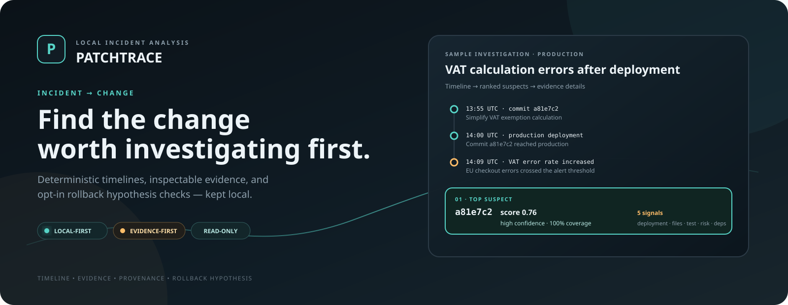
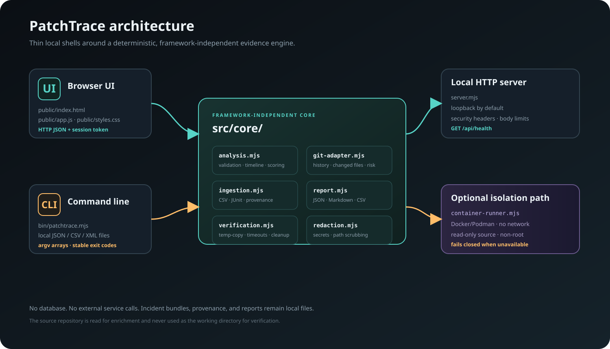
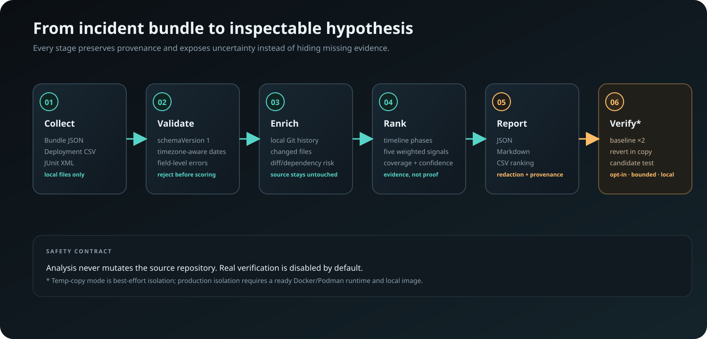
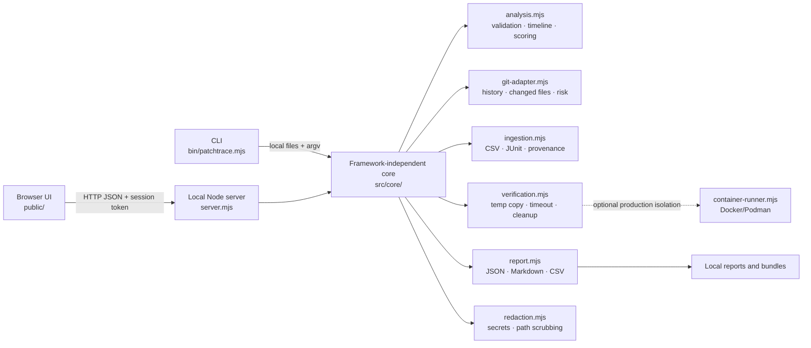

# PatchTrace

**Find the change worth investigating first.**

[](https://github.com/kaushalpatil09/PatchTrace/actions/workflows/ci.yml)
[](LICENSE)
[](https://nodejs.org/)
[](https://git-scm.com/)

<p align="center">
  
</p>

> **Project status:** early-stage release metadata (`0.1.0`). The main local vertical slice, safety controls, dependency-free UI, CLI, reports, Docker packaging, and automated checks are implemented. Production-hardening gaps are tracked in [`docs/IMPLEMENTATION_STATUS.md`](docs/IMPLEMENTATION_STATUS.md) and [`docs/PRODUCTION_READINESS.md`](docs/PRODUCTION_READINESS.md).

PatchTrace is a **local-first incident-to-change analyzer** for small engineering teams. It turns a versioned incident bundle and, optionally, a local Git repository into:

- a deterministic incident timeline;
- an evidence-backed ranking of candidate commits;
- inspectable factors, contributions, provenance, coverage, and missing signals; and
- an opt-in rollback hypothesis check in a temporary copy of the repository.

PatchTrace is intentionally **not** a chatbot, cloud observability dashboard, continuous monitoring service, or production rollback tool. A ranking is a hypothesis built from supplied evidence — not proof of root cause.

## Table of contents

- [Overview](#overview)
- [Features](#features)
- [Screenshots and visual demonstration](#screenshots-and-visual-demonstration)
- [Technology stack](#technology-stack)
- [Architecture](#architecture)
- [Project structure](#project-structure)
- [Prerequisites](#prerequisites)
- [Installation and setup](#installation-and-setup)
- [Configuration and environment variables](#configuration-and-environment-variables)
- [Usage](#usage)
- [How it works](#how-it-works)
- [CLI reference](#cli-reference)
- [HTTP API](#http-api)
- [Reports, provenance, and redaction](#reports-provenance-and-redaction)
- [Security and privacy](#security-and-privacy)
- [Testing and verification](#testing-and-verification)
- [Troubleshooting](#troubleshooting)
- [Performance, security, and limitations](#performance-security-and-limitations)
- [Future improvements](#future-improvements)
- [Contributing](#contributing)
- [License](#license)
- [Author and acknowledgements](#author-and-acknowledgements)
- [Further documentation](#further-documentation)

## Overview

After an incident, a team often knows that a deployment happened shortly before a failure but still has to compare commits, changed files, deployment records, and test output by hand. PatchTrace narrows that search without pretending to know more than the evidence supports.

It is designed for:

- maintainers and technical founders on small teams;
- open-source projects investigating regressions;
- engineers who need a reproducible local incident-analysis workflow; and
- teams that cannot or do not want to send private incident data to a third-party service.

The central product questions are:

1. **Which change should we inspect first?**
2. **What evidence connects that change to the failure?**
3. **Can a rollback hypothesis be reproduced safely before touching production?**

### Core principles

| Principle | What it means in this repository |
| --- | --- |
| **Local-first** | No accounts, telemetry, cloud calls, or external service calls are required for normal analysis. |
| **Zero runtime dependencies** | The application uses Node.js built-ins; the browser UI has no framework or third-party assets. |
| **Deterministic** | The same valid bundle and repository state produce the same ranking and evidence structure. |
| **Inspectable** | Suspects expose factors, weighted contributions, evidence sources, signal origin, coverage, and missing signals. |
| **Read-only by default** | Analysis and Git enrichment do not mutate the source repository. |
| **Opt-in verification** | Real repository verification is disabled unless explicitly enabled. |
| **Evidence over certainty** | Weak or incomplete evidence is labeled instead of converted into a confident-sounding answer. |

## Features

The following capabilities are implemented in the repository:

- Versioned `schemaVersion: 1` JSON incident bundles with field-level validation errors.
- Chronological timelines for commits, deployments, failed tests, and incident/operator events.
- Deterministic candidate ranking using five weighted signals:
  - temporal proximity to a matching deployment — **30%**;
  - incident-file overlap — **25%**;
  - failing-test overlap — **20%**;
  - diff risk — **15%**; and
  - dependency impact — **10%**.
- Coverage-aware confidence labels (`high`, `medium`, or `low`) and per-candidate missing-signal metadata.
- Local Git enrichment for commit history, changed files, derived diff risk, dependency-file impact, repository HEAD, branch, and dirty state.
- Deployment CSV and JUnit XML ingestion through `patchtrace ingest`.
- Browser UI for sample loading, local bundle import, timeline inspection, suspect selection, evidence details, fixture verification, optional real verification, and JSON report download.
- CLI commands for readiness checks, validation, ingestion, analysis, rollback verification, and report export.
- JSON, Markdown, and CSV report rendering with provenance and best-effort secret/path redaction.
- Fixture verification that reads stored demo results without executing a repository.
- Real verification that is disabled by default, bounded by time and output limits, and runs only in a temporary copy or explicitly requested constrained Docker/Podman mode.
- Local HTTP API with session tokens, `Host`/`Origin` checks, JSON-only POST bodies, structured errors, request limits, and a readiness endpoint.
- Accessibility-oriented browser behavior: skip link, semantic landmarks, live status regions, keyboard-safe native controls, visible focus, reduced-motion support, high-contrast/forced-colors fallbacks, and responsive layout.

## Screenshots and visual demonstration

The repository does not currently contain captured browser screenshots or a demo recording. To avoid presenting a fabricated screenshot as product output, the README uses purpose-built SVG illustrations based on the actual UI, source modules, and sample fixture.

### Product overview


*Illustrative project graphic. The sample values shown are based on the checked-in VAT incident fixture; this is not a live application screenshot.*

### Architecture



### Investigation workflow



## Technology stack

| Technology | Role |
| --- | --- |
| **Node.js 22+** | Runtime, HTTP server, CLI, file handling, child-process control, and built-in test runner. |
| **ECMAScript modules** | Source format (`"type": "module"`) used by the server, CLI, core engine, and tests. |
| **Node.js `node:http`** | Dependency-free local HTTP server and JSON API. |
| **Node.js built-ins** | Crypto hashing, filesystem operations, process execution, argument parsing, temporary workspaces, and redaction support. |
| **Git 2.31+** | Read-only repository history/enrichment and temporary-copy rollback operations. |
| **HTML/CSS/JavaScript** | Dependency-free browser interface under `public/`. |
| **Docker or Podman (optional)** | Constrained production-isolation verification mode; not required for local analysis. |
| **GitHub Actions** | Ubuntu and Windows CI matrix for Node 22/24, tests, smoke checks, doctor checks, and an Ubuntu Docker gate. |

There is no database, frontend build step, runtime framework, cloud service, telemetry client, or external API dependency in the current implementation.

## Architecture

The core analysis engine is intentionally independent of the web server and browser. The browser UI and CLI are thin local shells around the same modules.



There is no persistence layer. Incident bundles, provenance, and reports are local JSON/Markdown/CSV files. Git enrichment reads a normal local clone and does not upload the repository.

### Data flow

1. Read and validate a versioned incident bundle.
2. Optionally merge deployment CSV and JUnit XML evidence, recording hashes and parser provenance.
3. Optionally enrich candidates from a local Git repository without changing it.
4. Normalize timestamp handling and build a stable UTC-ordered timeline.
5. Filter candidates to the incident environment and configured pre-incident window.
6. Score each candidate with explicit factors, contributions, coverage, evidence, and missing signals.
7. Render the result in the browser, JSON, human-readable CLI output, Markdown, or CSV.
8. Optionally run a rollback hypothesis check in a marked temporary copy.
9. Export provenance including bundle hash, tool version, platform, and repository state when available.

## Project structure

```text
PatchTrace/
├── bin/
│   └── patchtrace.mjs          # CLI entry point
├── src/core/
│   ├── analysis.mjs            # Validation, timeline, scoring, CSV/JUnit parsers
│   ├── command-line.mjs        # Safe command-to-argv parsing
│   ├── container-runner.mjs    # Docker/Podman constrained runner
│   ├── git-adapter.mjs         # Local Git history and enrichment
│   ├── ingestion.mjs           # Bundle normalization and artifact provenance
│   ├── redaction.mjs           # Best-effort secret and path scrubbing
│   ├── report.mjs              # JSON, Markdown, and CSV report rendering
│   └── verification.mjs        # Temp-copy verification, timeouts, cleanup
├── public/
│   ├── index.html              # Browser UI markup
│   ├── app.js                  # Browser state, API calls, rendering
│   └── styles.css              # Dependency-free responsive UI styles
├── fixtures/
│   ├── sample-incident/        # Deterministic VAT regression fixture
│   └── faulty-incident/        # Synthetic discount regression fixture
├── scripts/
│   └── smoke.mjs               # Offline smoke check
├── tests/                      # Node built-in test suite
├── docs/                       # API, bundle, architecture, security, privacy, status
│   └── images/                 # README architecture and workflow illustrations
├── server.mjs                  # Local HTTP server and API routes
├── Dockerfile                  # Multi-stage non-root image
├── package.json                # Scripts, metadata, package entry point
├── .env.example                # Safe configuration template
├── LICENSE                     # MIT license
└── README.md                   # This document
```

## Prerequisites

- **Node.js 22 or newer.** The repository pins Node `22.23.3` in [`.nvmrc`](.nvmrc); the package engine is `>=22`.
- **Git 2.31 or newer.** Required for repository enrichment, readiness checks, and real verification.
- **npm** compatible with the installed Node.js release. The checked-in lockfile supports `npm ci`.
- **Docker or Podman** only for the constrained production-isolation verification mode.
- **A supported browser** for the local UI. The application itself has no remote browser dependency.

Normal analysis does not require network access, a database, cloud credentials, or a third-party service.

## Installation and setup

### 1. Clone the repository

```bash
git clone https://github.com/kaushalpatil09/PatchTrace.git
cd PatchTrace
```

### 2. Confirm the runtime

```bash
node --version
git --version
npm --version
```

Node must be `22.x` or newer and Git must be `2.31` or newer.

### 3. Install from the lockfile

```bash
npm ci
```

PatchTrace currently has no runtime dependencies. `npm ci` still validates the package metadata and lockfile from a clean checkout.

### 4. Run the readiness check

```bash
npm run doctor -- --json
```

The doctor command checks Node, Git, and temporary-directory writability. It also reports Docker/Podman and image readiness separately. Container readiness is optional for local analysis.

### 5. Start the local server

```bash
npm start
```

Open <http://127.0.0.1:4173> in a browser. The server binds to `127.0.0.1` by default and prints a per-start session token when `PATCHTRACE_TOKEN` is not set.

Expected startup shape:

```text
PatchTrace listening on http://127.0.0.1:4173
Session token: <generated-local-token>
```

Stop the server with `Ctrl+C`.

### Optional: use a `.env` file

Copy the safe template, edit only the values you need, and explicitly ask Node to load it:

```bash
cp .env.example .env
node --env-file=.env server.mjs
```

On PowerShell:

```powershell
Copy-Item .env.example .env
node --env-file=.env server.mjs
```

`npm start` runs `node server.mjs` and does **not** automatically load `.env`.

## Configuration and environment variables

All variables are optional; defaults are applied by the server or verification runner. Values marked **conditional** matter only when the related capability is enabled.

| Variable | Purpose | Required? | Example |
| --- | --- | --- | --- |
| `HOST` | Server bind address. Keep loopback unless exposure is deliberate. | Optional | `127.0.0.1` |
| `PORT` | HTTP port. Use `0` for an ephemeral port. | Optional | `4173` |
| `PATCHTRACE_ENABLE_VERIFY` | Enables real repository verification through the server/UI/API. | Optional, opt-in | `0` or `1` |
| `PATCHTRACE_ALLOWED_HOSTS` | Comma-separated additional hostnames accepted by `Host`/`Origin` checks. | Optional | `devbox.local` |
| `PATCHTRACE_VERIFY_ENV` | Comma-separated environment-variable allowlist for verification commands. | Optional, conditional | `APP_MODE,TEST_FLAG` |
| `PATCHTRACE_TOKEN` | Fixed API/session token. Empty means a random token per start. | Optional | `local-development-token` |
| `PATCHTRACE_VERIFY_ISOLATION` | Verification mode: `temp-copy` or `production` (mapped to constrained container mode). | Optional, conditional | `temp-copy` |
| `PATCHTRACE_CONTAINER_RUNTIME` | Explicit Docker or Podman executable name. | Optional, conditional | `docker` |
| `PATCHTRACE_VERIFY_IMAGE` | Existing local image for production isolation; the runner never pulls it. | Optional, conditional | `patchtrace:local` |
| `PATCHTRACE_VERIFY_USER` | Non-root numeric UID:GID for constrained containers. | Optional, conditional | `65532:65532` |
| `PATCHTRACE_VERIFY_CPUS` | CPU budget for each constrained verification container. | Optional, conditional | `1` |
| `PATCHTRACE_VERIFY_MEMORY` | Memory budget for each constrained verification container. | Optional, conditional | `512m` |
| `PATCHTRACE_VERIFY_PIDS_LIMIT` | Maximum process count in constrained containers. | Optional, conditional | `256` |
| `PATCHTRACE_VERIFY_TMPFS_SIZE` | Writable `/tmp` size in constrained containers. | Optional, conditional | `64m` |
| `PATCHTRACE_VERIFY_MAX_COPY_BYTES` | Maximum source-repository copy size for verification. | Optional, conditional | `2147483648` |
| `PATCHTRACE_VERIFY_MIN_FREE_BYTES` | Minimum free space required before creating a verification copy. | Optional, conditional | `268435456` |

The complete template is [`.env.example`](.env.example). Never commit real credentials, private keys, incident secrets, or a real fixed token.

## Usage

### Browser UI

With the server running, open <http://127.0.0.1:4173> and follow this flow:

1. Select **Load sample incident** to load the deterministic fixture, or use **Load incident bundle** to choose a local JSON file.
2. Review the UTC timeline for commits, deployments, failed tests, and incident events.
3. Inspect the ranked suspect changes, including score, confidence, and evidence coverage.
4. Select a suspect to inspect each signal, weighted contribution, evidence source, and `whyNot` explanation.
5. Use **Run sample verification (fixture)** to view stored demo evidence. This does not execute a repository.
6. If the server was started with real verification enabled, enter a trusted repository path and test command for a live rollback hypothesis check.
7. Use **Download JSON** to build a server-side, redacted report with provenance.

The sample fixture ranks commit `a81e7c2` first because it was deployed shortly before the incident, changed an implicated file, and overlaps the failing `VAT-07` test. The ranking remains evidence, not a root-cause verdict.

An additional schema-valid demo bundle with a clearly faulty pricing change is available at [`fixtures/faulty-incident/manifest.json`](fixtures/faulty-incident/manifest.json). It ranks commit `9f8e7d6` first and can be loaded through **Load incident bundle** or analyzed from the CLI.

### Real verification versus fixture verification

| Mode | What it does | Safety/meaning |
| --- | --- | --- |
| **Fixture verification** | Reads the server-owned verification entry in `fixtures/sample-incident/manifest.json`. | Deterministic demo evidence; no repository or test command is executed. |
| **Temp-copy verification** | Copies a trusted Git worktree, runs the baseline command twice, reverts the candidate only in the copy, and runs the command again. | Opt-in and bounded, but **best-effort isolation, not a sandbox**. The test command may still access the host. |
| **Production isolation** | Runs verification phases in fresh Docker/Podman containers with no network, non-root identity, read-only source mount, writable workspace, and resource limits. | Requires a ready local runtime and pre-built image; fails closed instead of silently falling back. |

To enable live verification for a local trusted preview:

```bash
PATCHTRACE_ENABLE_VERIFY=1 npm start
```

PowerShell:

```powershell
$env:PATCHTRACE_ENABLE_VERIFY = "1"
npm start
```

For production-isolation mode, configure `PATCHTRACE_VERIFY_ISOLATION=production`, build or provide the configured local image, and confirm readiness with:

```bash
npm run doctor -- --strict-container
```

### Incident bundle example

The analyzer accepts a versioned JSON bundle. Timestamps must include a timezone (`Z` or an explicit offset):

```json
{
  "schemaVersion": 1,
  "title": "Checkout errors after deploy",
  "summary": "EU checkout started failing after the 14:00 deployment.",
  "environment": "production",
  "incidentStart": "2026-10-20T14:09:00Z",
  "candidateWindowMinutes": 1440,
  "incidentFiles": ["src/tax.ts"],
  "commits": [
    {
      "sha": "a81e7c2",
      "timestamp": "2026-10-20T13:55:00Z",
      "message": "Simplify VAT exemption calculation",
      "changedFiles": ["src/tax.ts", "tests/vat.test.ts"],
      "diffRisk": 0.88,
      "dependencyImpact": 0.72
    }
  ],
  "deployments": [
    {
      "commitSha": "a81e7c2",
      "timestamp": "2026-10-20T14:00:00Z",
      "environment": "production"
    }
  ],
  "tests": [
    {
      "name": "VAT-07",
      "status": "failed",
      "timestamp": "2026-10-20T14:10:00Z",
      "relatedFiles": ["src/tax.ts", "tests/vat.test.ts"],
      "errorSignature": "expected exempt order to have zero tax"
    }
  ]
}
```

See [`docs/INCIDENT_BUNDLE.md`](docs/INCIDENT_BUNDLE.md) for the complete field reference and [`docs/incident-bundle.schema.json`](docs/incident-bundle.schema.json) for the machine-readable schema.

## How it works

### 1. Validate and normalize evidence

PatchTrace validates the bundle before scoring. It rejects unsupported schema versions, missing required fields, invalid SHAs, timestamps without timezones, reversed incident windows, invalid numeric ranges, malformed collections, and oversized inputs. The `ingest` command can merge deployment CSV and JUnit XML into a validated bundle while recording artifact hashes, parser versions, source paths, and ingestion time.

### 2. Select the candidate window

Candidates are commits at or before `incidentStart` and inside `candidateWindowMinutes` (default: 24 hours). Deployments must match the incident environment to contribute temporal evidence. Post-incident deployments and deployments that occurred before a candidate commit receive zero temporal credit.

### 3. Compute transparent signals

For each candidate, PatchTrace computes or records:

| Signal | Weight | What contributes |
| --- | ---: | --- |
| Temporal proximity | 30% | A matching deployment after the commit and before the incident; closer deployments score higher. |
| Incident-file overlap | 25% | Changed files that overlap `incidentFiles`. |
| Test overlap | 20% | Failing tests whose `relatedFiles` overlap the commit's changed files. |
| Diff risk | 15% | The supplied `diffRisk`, or a bounded Git-churn derivation during repository enrichment. |
| Dependency impact | 10% | The supplied `dependencyImpact`, or a transparent heuristic from supported dependency manifests/lockfiles and diff churn. |

Each output contains raw factor values, weighted contributions, `signalSources` (`derived`, `provided`, or `missing`), `coverage`, `missingSignals`, and human-readable evidence items. High confidence requires both a high score and at least 80% signal coverage.

### 4. Enrich from a local repository

When `--repo` is supplied, PatchTrace reads a normal Git worktree with bounded history and diff output. It can fill changed files, derive diff risk, derive dependency-file impact, and record repository HEAD, branch, dirty state, and truncation details. It never mutates the source repository during analysis.

The supported enrichment path rejects linked worktrees, submodule checkouts, bare repositories, shallow clones, repository roots, dirty worktrees for verification, and symlinks that escape the repository.

### 5. Optionally test a rollback hypothesis

Real verification:

1. Validates the repository and source fingerprint.
2. Checks repository-copy size and available temporary space.
3. Creates a marked temporary workspace outside the source repository.
4. Copies the repository and checks symlink safety again.
5. Runs the baseline command twice by default.
6. Stops with an inconclusive result if baseline runs disagree or if the baseline already passes.
7. Runs `git revert --no-commit` only in the temporary workspace.
8. Runs the candidate test command again and compares the result.
9. Caps command output, applies best-effort redaction, removes the temporary workspace, and re-checks the source fingerprint.

A `confirmed` result supports the rollback hypothesis in the temporary copy or constrained container. It does not prove root cause, production safety, or that the candidate was the only contributing change.

## CLI reference

The CLI is a thin shell around the same core engine used by the server. Invoke it through npm:

```bash
npm run patchtrace -- <command> [options]
```

Or call the entry point directly:

```bash
node bin/patchtrace.mjs <command> [options]
```

### Commands

| Command | Purpose |
| --- | --- |
| `doctor [--json] [--strict-container]` | Check Node, Git, temporary workspace, and optional container readiness. |
| `validate <bundle.json> [--json]` | Validate a bundle without analyzing it. Use `-` for stdin. |
| `ingest <bundle.json> --out <bundle.json> ...` | Merge bundle overrides, deployment CSV, JUnit XML, and optional Git enrichment. |
| `analyze <bundle.json> ...` | Rank candidates and emit human-readable, JSON, Markdown, or CSV output. |
| `verify --repo <path> --sha <sha> ...` | Run an opt-in, bounded rollback hypothesis check. |
| `report <bundle.json> ...` | Build a Markdown, JSON, or CSV report, optionally including verification JSON. |

### Validate and analyze

```bash
node bin/patchtrace.mjs validate fixtures/sample-incident/manifest.json
node bin/patchtrace.mjs validate bundle.json --json
node bin/patchtrace.mjs analyze fixtures/sample-incident/manifest.json
node bin/patchtrace.mjs analyze fixtures/sample-incident/manifest.json --json
node bin/patchtrace.mjs analyze bundle.json --repo /path/to/repository --json
```

`--repo` requires a normal clone and reads at most 200 commits by default. Use `--max-commits` to select a value up to 500.

### Ingest local deployment and test evidence

```bash
node bin/patchtrace.mjs ingest incident.json \
  --repo /path/to/repository \
  --deployments deployments.csv \
  --junit test-results.xml \
  --incident-start 2026-10-20T14:09:00Z \
  --environment production \
  --out normalized-incident.json
```

The command preserves the bundle v1 contract and adds best-effort ingestion provenance. Treat recorded source paths as sensitive local metadata.

### Export reports

```bash
node bin/patchtrace.mjs report bundle.json --format markdown --out report.md
node bin/patchtrace.mjs report bundle.json --format json --out report.json
node bin/patchtrace.mjs report bundle.json --format csv --out ranking.csv
```

Use `--generated-at <ISO-8601-with-timezone>` when a reproducible report timestamp is required.

### Verify a candidate in a temporary copy

```bash
node bin/patchtrace.mjs verify \
  --repo /path/to/repository \
  --sha abc1234 \
  --test-command "npm test" \
  --timeout 30000 \
  --json
```

For unusual quoting, pass an explicit argv array:

```bash
node bin/patchtrace.mjs verify \
  --repo /path/to/repository \
  --sha abc1234 \
  --test-command '["npm","test","--","--runInBand"]'
```

The `--timeout` value is per command and accepts `1`–`600000` milliseconds. The default baseline runs twice. CLI exit codes are:

| Code | Meaning |
| ---: | --- |
| `0` | Success or confirmed rollback hypothesis. |
| `1` | Not confirmed, inconclusive, or doctor found a local problem. |
| `2` | Invalid input, unsupported repository layout, or usage error. |
| `3` | Timeout. |
| `4` | Command, runner, or revert error. |

## HTTP API

The server exposes a local, single-user JSON API at `http://127.0.0.1:4173` by default. Every JSON response includes `apiVersion: 1`.

### Authentication

- `GET /` is public and establishes an `HttpOnly`, `SameSite=Strict` session cookie.
- `GET /api/health` is public but still validates the `Host` header.
- Other API routes require the session cookie or one of these headers:

  ```http
  Authorization: Bearer <token>
  X-PatchTrace-Token: <token>
  ```

The token is generated at startup unless `PATCHTRACE_TOKEN` is set. The server accepts `127.0.0.1`, `localhost`, and `[::1]` by default, plus values listed in `PATCHTRACE_ALLOWED_HOSTS`. Browser requests with an `Origin` header must be same-origin.

### Routes

| Method | Route | Auth | Purpose |
| --- | --- | --- | --- |
| `GET` | `/` | Public | Serve the browser UI and set the session cookie. |
| `GET` | `/api/health` | Host-checked | Report Node, Git, temporary-directory, and verification readiness. |
| `GET` | `/api/sample` | Token | Return the deterministic sample incident bundle. |
| `POST` | `/api/analyze` | Token | Validate and analyze the bundle in the request body. |
| `POST` | `/api/report` | Token | Build a versioned, redacted report from an analysis object. |
| `POST` | `/api/verify` | Token | Read fixture verification or run opt-in real verification. |
| `POST` | `/api/verify/cancel` | Token | Request cancellation of the active real verification. |

The full route and contract reference is [`docs/API.md`](docs/API.md); the hand-written OpenAPI document is [`docs/openapi.yaml`](docs/openapi.yaml).

### Readiness

```bash
curl http://127.0.0.1:4173/api/health
```

The response includes `status`, `ready`, tool version, Node version, platform, Git availability/version, temporary-directory writability, `realVerificationEnabled`, and `verificationInProgress`. It never includes the session token.

### Analyze a bundle

```bash
curl -X POST http://127.0.0.1:4173/api/analyze \
  -H "Authorization: Bearer <token>" \
  -H "Content-Type: application/json" \
  --data-binary @fixtures/sample-incident/manifest.json
```

The request body is the bundle itself, not a wrapper. Invalid input returns a structured `400` response with field paths such as `commits[0].timestamp`.

### Build a report

```bash
curl -X POST http://127.0.0.1:4173/api/report \
  -H "Authorization: Bearer <token>" \
  -H "Content-Type: application/json" \
  --data-binary @analysis-request.json
```

The request contains `analysis`, optional `verification`, and optional `provenance`. The server supplies `generatedAt` and `toolVersion`; report output includes `schemaVersion`, redaction counters, and the redacted analysis.

### Verification request

Fixture verification:

```json
{
  "analysis": { "...": "full analysis response" },
  "sha": "a81e7c2"
}
```

Real verification, available only when `PATCHTRACE_ENABLE_VERIFY=1`:

```json
{
  "repoPath": "/path/to/checkout",
  "sha": "a81e7c2",
  "testCommand": ["npm", "test"],
  "timeoutMs": 30000,
  "mainline": 1
}
```

Only one real verification runs at a time. Requests use JSON, verification bodies are capped at 1 MB, and a command timeout is limited to 10 minutes. The verifier rejects dirty worktrees, linked worktrees, submodules, bare/shallow repositories, filesystem roots, and symlinks that escape the repository.

## Reports, provenance, and redaction

PatchTrace can render analysis as:

- **JSON** — versioned structured data for automation;
- **Markdown** — incident summary, UTC timeline, ranked suspects, factor contributions, evidence, verification, uncertainty, and provenance; and
- **CSV** — one row per ranked candidate with score, confidence, coverage, factor values, and missing signals.

Reports can record:

- bundle SHA-256;
- PatchTrace version and platform;
- Node version for CLI-generated reports;
- repository HEAD, branch, and dirty state when `--repo` is used;
- optional verification results; and
- redaction and path-scrubbing counts.

Report exports apply best-effort redaction to private keys, common token formats, bearer tokens, JWTs, URL credentials, and `password`/`token`/`secret`-style assignments. Absolute local filesystem and home-directory paths are scrubbed in report exports while repository-relative evidence paths remain available.

Redaction is not a guarantee. Raw `/api/analyze` responses are not report exports and are not path-scrubbed. Review every export before sharing it.

## Security and privacy

PatchTrace is designed for a trusted operator on a local machine:

- normal analysis makes no outbound requests and uses no telemetry, analytics, accounts, or cloud services;
- incident bundles are data and are never evaluated as code;
- the local API uses a per-start token (or an explicitly configured fixed token), same-origin checks, JSON-only request bodies, body limits, and security headers;
- source repositories are not mutated during analysis or verification;
- verification commands receive an allowlisted environment instead of the full process environment;
- command output is capped and best-effort redacted; and
- production isolation requires Docker or Podman, disables container networking, mounts the source read-only, uses a non-root identity, and applies CPU/memory/PID/tmpfs limits.

Important boundary: the default `temp-copy` runner is **not a security sandbox**. A trusted test command can still access the host filesystem or network. Do not enable live verification on a server exposed to untrusted users. Use constrained container mode or a dedicated VM when a stronger operational boundary is needed.

Read [`docs/SECURITY.md`](docs/SECURITY.md) for the threat model and verification boundary, [`docs/PRIVACY.md`](docs/PRIVACY.md) for data handling, and [`SECURITY.md`](SECURITY.md) for vulnerability-reporting guidance.

## Testing and verification

The repository uses Node.js's built-in test runner and an offline smoke script. There is no separate test framework or build step.

### Standard checks

```bash
npm ci
npm test
npm run smoke
npm run doctor -- --json
npm run security
```

Additional focused commands:

```bash
npm run test:ui
npm run test:cli
npm run test:coverage
npm run check
```

`npm run test:coverage` enables Node's built-in coverage instrumentation; the repository does not claim a coverage percentage until the output is reviewed. `npm run security` runs the npm audit for the installed dependency graph.

### What the tests cover

The suite covers validation, timeline ordering, scoring and confidence, short/full SHA matching, dependency-impact derivation, CSV/JUnit parsing and limits, Git enrichment, ingestion provenance, report rendering/redaction, API authentication and contracts, UI static/accessibility wiring, temporary-copy verification, container preflight, timeouts, cancellation, stale-workspace cleanup, source-integrity checks, and synthetic maximum-size inputs.

### Verification performed while preparing this README

The following commands were run successfully in this checkout on **October 21, 2026**:

| Command | Observed result |
| --- | --- |
| `npm test` | 102 tests, 0 failed; 1 Windows-only symlink test skipped. |
| `npm run smoke` | Auth, sample API, analysis, fixture verification, and redacted report export reported available. |
| `npm run doctor -- --strict-container` | Node, Git, temporary workspace, Docker `29.8.2`, and `patchtrace:local` all reported ready. |
| `npm run security` | `npm audit --omit=dev --audit-level=high` reported 0 vulnerabilities. |
| `npm run test:ui` | 6 UI static/accessibility checks passed. |
| `npm run test:cli` | 7 CLI checks passed. |
| `npm run check` | Test, smoke, and doctor gates completed successfully. |
| Production-isolation verification | Docker `29.8.2` + `patchtrace:local`; baseline failed, the candidate reverted in the isolated workspace, and the candidate phase passed. |

After Docker was enabled, the strict doctor gate reported all checks ready. A synthetic repository with a failing candidate was also verified through the production container runner on Windows.

## Troubleshooting

| Symptom | Likely cause | Resolution |
| --- | --- | --- |
| `node` or `git` is too old or missing | The runtime does not meet the documented prerequisites. | Install Node.js 22+ and Git 2.31+, then rerun `npm run doctor -- --json`. |
| `npm start` reports that the port is in use | Another process owns the configured port. | Set another port, for example `PORT=8080 npm start` or `$env:PORT="8080"; npm start`. |
| API requests return `401 unauthorized` | The browser session cookie or API token is missing/expired. | Load `/` first, or send `Authorization: Bearer <token>` / `X-PatchTrace-Token: <token>`. |
| API requests return `403 host_not_allowed` or `origin_not_allowed` | The request host/origin is outside the local allowlist. | Use `127.0.0.1`, `localhost`, or `[::1]`, or deliberately add a trusted hostname to `PATCHTRACE_ALLOWED_HOSTS`. |
| A `.env` change has no effect | `npm start` does not load `.env` automatically. | Run `node --env-file=.env server.mjs`, or export variables in the shell before `npm start`. |
| No candidates are ranked | Commits are outside the pre-incident window, timestamps are wrong, or no commits were supplied. | Check timezone-aware timestamps and widen `candidateWindowMinutes`; use `--repo` when the bundle intentionally omits commits. |
| Real verification is disabled | The server defaults to fixture-only verification. | Restart with `PATCHTRACE_ENABLE_VERIFY=1` and use only a trusted repository and test command. |
| Verification rejects the repository | The worktree is dirty, linked, shallow, bare, contains submodules, or has unsafe symlinks. | Use a clean normal clone and rerun `doctor`/verification. PatchTrace fails closed for these layouts. |
| Production isolation is unavailable | Docker/Podman or the configured local image is missing. | Build/configure the image and run `npm run doctor -- --strict-container`; production mode never falls back silently. |
| Verification stops before copying | The repository exceeds the copy limit or temporary free-space requirement. | Review `PATCHTRACE_VERIFY_MAX_COPY_BYTES`, `PATCHTRACE_VERIFY_MIN_FREE_BYTES`, and the repository size before raising limits. |
| A command does not parse as intended | Shell quoting differs across platforms. | Pass an explicit JSON argv array such as `["npm","test","--","--runInBand"]`. |

For API status codes, verification outcomes, parser errors, and the security boundary, see [`docs/API.md`](docs/API.md), [`docs/INCIDENT_BUNDLE.md`](docs/INCIDENT_BUNDLE.md), and [`docs/SECURITY.md`](docs/SECURITY.md).

## Performance, security, and limitations

### Operational limits

These bounds are implemented to keep local processing predictable. They are not a benchmark or a promise of throughput:

| Area | Current bound or default |
| --- | --- |
| Analysis/report API request body | 5 MB |
| Verification API request body | 1 MB |
| CLI input files | 5 MB |
| Bundle collections | 2,000 commits, 2,000 deployments, 5,000 tests, 5,000 files per relevant collection, 2,000 incident events |
| Deployment SHA list | 1,000 SHAs per deployment |
| Git enrichment | 200 commits by default, 500 maximum; 5,000 changed files per commit; 100,000 changed lines by default, 1,000,000 maximum |
| JUnit parser | 1,000,000 characters, 10,000 tags, nesting depth 256 |
| Verification | 30,000 ms default per command, 600,000 ms maximum per command, two baseline runs by default, one live run per server |
| Command output | 256 KB per stdout/stderr stream, with truncation markers |
| Temporary repository copy | 2 GiB default maximum; 256 MiB default free-space reserve |

### Current limitations

The following are verified limitations or deliberate scope boundaries, not hidden features:

- The default temp-copy verifier is best-effort isolation, not a sandbox. A trusted command may access the host filesystem, network, CPU, or memory.
- Production isolation requires a Docker/Podman daemon, a pre-built local image, and a trusted host. A dedicated VM is the stronger operational boundary.
- Dependency impact is a transparent heuristic based on supported manifest/lockfile paths and bounded diff churn; it is not a full source-level package graph.
- Diff risk is derived from bounded line churn when Git enrichment is used; it is not a semantic code-risk model.
- There is no persistence, investigation history, account system, multi-user mode, upload service, or rate limiter.
- The HTTP server is intended for one local operator and is not designed for direct internet exposure.
- Report redaction is pattern-based and best-effort. Raw analysis responses remain sensitive, and repository-relative evidence can still disclose private context.
- The current repository does not claim a coverage percentage or dedicated-VM verification result without running and reviewing those checks in the target environment.
- No code path performs a production rollback or writes to a production system.

## Future improvements

These are **suggestions for future work**, not current functionality:

- Validate live container and dedicated-VM verification on representative repositories and slow test commands.
- Add generated API-schema tooling while preserving the dependency-free local runtime.
- Expand dependency analysis from file heuristics to an inspectable source-level package graph.
- Add large-repository and slow-command performance measurements with published, reproducible workloads.
- Complete assistive-technology review of the browser flow in addition to the current static accessibility checks.
- Consider local investigation history only if versioned JSON bundles and reports no longer meet the product need.

## Contributing

Contributions are welcome when they preserve PatchTrace's local-first, deterministic, evidence-oriented scope.

Before opening a change, read [`CONTRIBUTING.md`](CONTRIBUTING.md) and [`AGENTS.md`](AGENTS.md). The repository's documented local workflow is:

```bash
npm ci
npm test
npm run smoke
npm run doctor -- --json
npm run security
```

When changing analysis, API, parser, reporting, or verification behavior:

- keep `src/core/` framework-independent;
- add a meaningful automated regression test;
- do not mutate a source repository during verification;
- keep commands bounded and use explicit isolation boundaries;
- treat bundles and parser input as untrusted;
- keep secrets, real incident data, and absolute local paths out of commits; and
- do not claim Docker, coverage, or remote CI results unless those checks actually ran.

Use the repository issue tracker for bug reports and focused feature proposals: <https://github.com/kaushalpatil09/PatchTrace/issues>.

## License

PatchTrace is distributed under the **MIT License**. See [`LICENSE`](LICENSE) and the `license` field in [`package.json`](package.json). The license documented here is the license currently present in this repository; it is not Apache-2.0.

## Author and acknowledgements

- **Author:** Kaushal Patil
- **Repository:** <https://github.com/kaushalpatil09/PatchTrace>
- **Issues:** <https://github.com/kaushalpatil09/PatchTrace/issues>

PatchTrace relies on the Node.js runtime, Git, and the standard GitHub Actions/Docker tooling already described in the repository. No external runtime service is required by the application.

## Further documentation

| Document | Description |
| --- | --- |
| [`docs/PRODUCT.md`](docs/PRODUCT.md) | Product goals, users, constraints, and acceptance criteria. |
| [`docs/ARCHITECTURE.md`](docs/ARCHITECTURE.md) | Detailed data flow, scoring contract, safety boundary, and extension points. |
| [`docs/INCIDENT_BUNDLE.md`](docs/INCIDENT_BUNDLE.md) | Bundle v1 field-by-field reference, ingestion rules, and limits. |
| [`docs/incident-bundle.schema.json`](docs/incident-bundle.schema.json) | Machine-readable bundle schema. |
| [`docs/API.md`](docs/API.md) | Local HTTP routes, authentication, errors, and verification contracts. |
| [`docs/openapi.yaml`](docs/openapi.yaml) | Checked-in OpenAPI description for the current local routes. |
| [`docs/SECURITY.md`](docs/SECURITY.md) | Threat model, verification behavior, and known security boundaries. |
| [`docs/PRIVACY.md`](docs/PRIVACY.md) | Local data handling and network behavior. |
| [`docs/IMPLEMENTATION_STATUS.md`](docs/IMPLEMENTATION_STATUS.md) | Implemented behavior, tested areas, and remaining gaps. |
| [`docs/PRODUCTION_READINESS.md`](docs/PRODUCTION_READINESS.md) | Draft production-readiness requirements and release gates. |
| [`CHANGELOG.md`](CHANGELOG.md) | User-visible changes and known limitations. |
| [`CONTRIBUTING.md`](CONTRIBUTING.md) | Contributor setup, workflow, and repository rules. |
